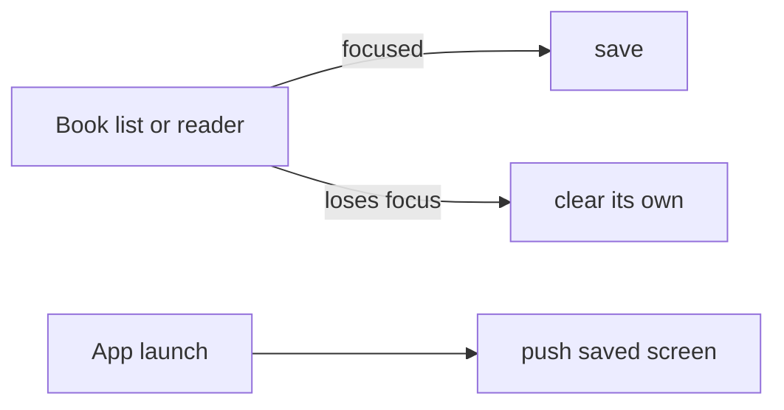

# Reading checkpoint

Reopens the book list or chapter the user was on when the app was closed.

See also: [App architecture](./app-architecture.md).

## Behavior

- The book list saves its language. The reader saves the chapter (the one playing if the audio panel is open, else the one on screen) and where it was opened from.
- One checkpoint is kept, from the screen focused last. Leaving a screen clears its checkpoint, so Back to Home means the next launch shows Home.
- At launch, Home pushes the book list, or the reader's parent screen and then the reader, so Back works as before the restart. The parent has a `restored=1` param, which `_layout.tsx` shows without an animation. Home stays blank until the restored screen covers it.

## Files

| File | Holds |
|------|-------|
| `domain/reading-checkpoint.ts` | parsing, equality, route params, screens to push at launch |
| `db/reading-checkpoint-preferences.ts` | the `reading_checkpoint` preference row |
| `stores/reading-checkpoint-store.ts` | the checkpoint in memory; save and clear |
| `hooks/use-persist-reading-checkpoint.ts` | save while focused, clear on losing focus |
| `app/books.tsx`, `app/read.tsx` | build the checkpoint |
| `app/index.tsx` | restores once at launch |

## Rules worth keeping

- **A screen clears only its own checkpoint.** Going Back from the reader to the book list, the list's save and the reader's clear can arrive in either order.
- **Saves are skipped while a screen isn't focused.** Otherwise a reader left under another screen saves itself again.
- **Saves and clears are immediate.** Each write is one small SQLite row, so no debounce or delay is needed.
- **Home restores only on its first mount** (`takeLaunchCheckpoint`), or later renders would redirect into the reader.
