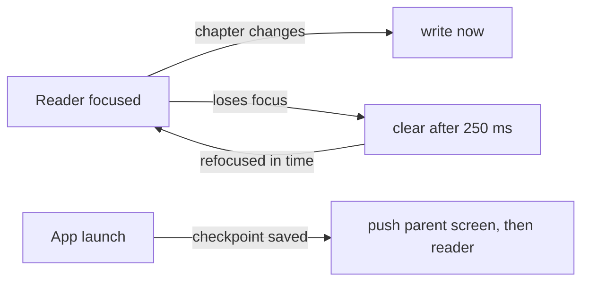

# Reading checkpoint

Reopens the chapter the user was reading when the app was closed.

See also: [App architecture](./app-architecture.md) for where stores, preferences and domain rules live.

## Behavior

- While the reader is open, the app remembers the language, book, chapter, whether it is audio-only, and where the reader was opened from (book list or Downloads Library).
- The chapter remembered is the one playing when the audio panel is open, otherwise the one on screen.
- On the next launch, Home pushes the screen the reader came from and then the reader, so Back walks the same path as before the restart. The parent is pushed with a `restored=1` param, which the stack in `_layout.tsx` shows without an animation, so only the reader slides in. Home renders blank until the reader covers it, so it doesn't flash first.
- Leaving the reader in any way (toolbar Back, Android Back, iOS swipe-back, or opening another screen on top) forgets the checkpoint, and the next launch shows Home.

## Files

| File | Holds |
|------|-------|
| `domain/reading-checkpoint.ts` | parse/serialize, equality, route params, the parent screen to restore (pure, tested) |
| `db/reading-checkpoint-preferences.ts` | the `reading_checkpoint` row in `preferences` (JSON) |
| `stores/reading-checkpoint-store.ts` | in-memory checkpoint, writes, the delayed clear (tested) |
| `hooks/use-persist-reading-checkpoint.ts` | reader focus, saving, scheduling the clear |
| `app/read.tsx` | picks the chapter and builds the checkpoint |
| `app/index.tsx` | restores at launch, once |
| `components/download/downloads-library-view.tsx` | marks chapters opened from the library with `from=downloads-library` |

## Timing

- **Save, immediate.** Each new checkpoint is written right away; an unchanged one is skipped. A fast scroll through short chapters (Psalms) writes once per chapter passed, which is one small SQLite upsert each and costs far less than the per-chapter audio check the reader already does. With no pending save, nothing needs flushing when the app goes to the background.
- **Clear, 250 ms delay (intentional; keep it).** A reader that loses focus and regains it right away keeps its checkpoint. This is the only clear: the toolbar's Back does not clear on its own, because the reader is still focused at that point and its next re-render would save again.

## Gotchas

- Saves are skipped while the reader is not focused. Without that, a reader left under another screen (for example the Downloads Library opened from the Settings drawer) saved itself again, and the next launch reopened it.
- Home restores only on its first mount after launch (`takeLaunchCheckpoint`). The store's value changes while a reader is open, so reading it on later renders redirected back into the reader.
- Backing out of the reader and sending the app to the background within 250 ms can leave the checkpoint saved, so the next launch reopens that chapter.
